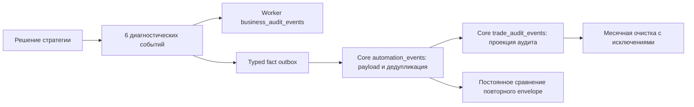

# Архитектура БД: статусы, аудит и хранение — 11.10.2026

## Решение

Оптимизацию хранения следует выделить в отдельную работу. Главная причина большого объёма — число записей и повторное хранение диагностических payload. Статусная модель требует точечных исправлений инвариантов и типизации; переписывание всех статусов в native PostgreSQL ENUM эту проблему хранения не решает.

Рекомендован порядок: **D1 — строгие составные CHECK; D2 — сокращение будущей диагностической записи; D3 — измерение и точечные индексы**. Permanent receipt/diagnostic body separation — последующая D4, если после D2 сохранённый объём и рост всё ещё требуют этого. Ни одна из этих реализаций в рамках оценки не выполнялась.

Сохраняются границы: Core владеет PostgreSQL, Worker — своей durable SQLite, транспорт между ними HTTP. Финансовая история, постоянные ключи повторов, незавершённые операции и исходные volumes остаются сохранёнными. Источники: [AGENT_BRIEF](../../AGENT_BRIEF.md), [месячная retention](../../develop/database-retention.md), [исследование оркестрации](orchestration-and-worker-storage.md).

## Свежие доказательства и пределы измерения

Снимок **11.10.2026, 12:36:12–12:36:17 МСК**: [database-live.json](../../develop/reports/database-architecture-20261011/database-live.json), [collector](../../develop/reports/database-architecture-20261011/collect_database_readonly.py). Shared PostgreSQL **16.15**, migration head `0005_order_quota_percent`, 24 таблицы, включая Alembic, 45 FK и 69 индексов; пользовательских native ENUM нет. Размер `pg_database_size` **8 611 060 759 B = 8,611 GB = 8,020 GiB**. Это размер текущей БД, включая её таблицы/индексы; не размер всего Docker volume, WAL или свободного места узла.

Все 14 PG-запросов завершились. Использованы READ ONLY transactions, statement timeout 5s / lock timeout 1s и ROLLBACK; системные каталоги, накопительная статистика и ограниченные агрегаты. Payload, аккаунты, токены и значения идентификаторов не выводились. Рабочая БД не использовалась для тестов, проверки целостности, EXPLAIN ANALYZE, ANALYZE/VACUUM, DDL или DELETE.

`n_live_tup`, `reltuples`, `pg_stats.null_frac/avg_width/correlation` — оценки. `stats_reset=NULL`: начало окна накопительных counters неизвестно; счётчики сканов не показывают latency и не являются разрешением удалить индекс. `pg_stat_statements` не установлен: query p95 и вклад конкретных SQL не измерены. Lifetime `temp_bytes≈25,3 GB /46 files` не доказывает текущий spill или источник нагрузки. [PostgreSQL: cumulative statistics](https://www.postgresql.org/docs/16/monitoring-stats.html).

Для больших таблиц `TABLESAMPLE SYSTEM`: events/audit 0,03%, decisions 0,2%, seed 11, максимум 4000 строк на таблицу. Финальные выборки меньше ограничения, но остаются блоковыми и коррелированными, без гарантии представительности. Первое измерение 0,2% events/audit упёрлось в лимит и обрезало поздние даты; оно сохранено в `database-live-initial.json` и не используется для итоговых долей. Статусы — первые не более 2000 строк без случайного отбора. Размер текста JSON и размер datum не равны физической экономии всего отношения.

## Где находится объём

В таблице GB означают десятичные 10⁹ B; оценки строк округлены. Total включает heap, индексы и вспомогательное хранение, поэтому total может немного превышать их сумму.

| Таблица | Total GB | Heap GB | Индексы GB | Оценка живых строк |
|---|---:|---:|---:|---:|
| `automation_events` | 5,951 | 4,626 | 1,324 | 4,764 млн |
| `trade_audit_events` | 1,874 | 1,455 | 0,419 | 3,672 млн |
| `trade_decisions` | 0,737 | 0,566 | 0,170 | 0,553 млн |

Эти три таблицы занимают **99,43% БД**. Все индексы вместе — **1,936 GB /22,48% БД**. TOAST каждой из трёх больших таблиц — только 8192 B: здесь большой heap, а не накопившиеся внешние TOAST bodies. У этих таблиц `n_dead_tup=0` по текущей оценке и `n_tup_del=0`; данных для объявления bloat причиной объёма нет. Полный bloat scan не выполнялся.

БД общая для TEST и PROD. Все **1592** выбранные envelopes относятся к **TEST**; выборка audit/decisions также историческая по диапазону дат. Поэтому многогигабайтный footprint нельзя называть измеренным текущим ростом PROD. Отдельные исходные TEST-тома и исторические финансовые факты не подлежат автоматическому удалению по environment.

PROD Worker: SQLite 3.46.1, десять таблиц, main **159 744 B**, WAL **82 432 B**, SHM **32 768 B**; 39 pages ×4096, freelist 0. В read-only снимке: одна cached automation, один lot, 15 business audit rows, outbox/intents/decisions — 0. Это моментальное состояние, не приёмка торговли или доказательство отсутствия иных операций. Из десяти live DDL ни один не содержит CHECK.

## Статусы: что исправлять

Основные состояния уже представлены enum: AutomationState, PositionCycleState, BrokerOrderState, AdmissionStatus, SubmitReservationState. В PostgreSQL они хранятся как VARCHAR с CHECK допустимых значений. Для автомата есть общая FSM и проверки origin/terminal/revision; заменять её новой универсальной схемой не требуется.

Независимые признаки сохраняют самостоятельный смысл:

- `strategy_enabled`, `access_mode`, admission status, owner/generation, lease, baseline и reconciliation отвечают на разные вопросы допуска. `ARMED` может сочетаться с истёкшей lease; `effective_can_submit` вычисляется.
- `resume_requested` — намерение человека, `state` — подтверждённое состояние; `hold_reason` и предыдущий state нужны для HOLD.
- `sell_armed`, `pending_low`, свечные/ценовые якоря — состояние стратегии. `terminal_at`, `execution_facts_emitted_at`, `clean_shutdown` — разные доказательства durability.
- Audit `stage` — вид события, `level` — тяжесть, `critical` — действующая защита retention. Они не являются тремя альтернативными представлениями одного статуса.

Подробная карта и callers: [status-code-findings.md](../../develop/reports/database-architecture-20261011/status-code-findings.md).

Два существенных дефекта проверены по коду и **фактическим определениям live CHECK**, без проверки рабочих строк:

| Приоритет / место | Разрешённый схемой сценарий | Исправление |
|---|---|---|
| D1 / `models/automation_facts.py:38` | Bootstrap IDs/currency/time заданы, один из quantity/average/invested — NULL. CHECK вычисляет UNKNOWN и пропускает неполный снимок; command reader может остановиться с RuntimeError. | Явные `IS NOT NULL` для всех трёх чисел в complete-ветке; сохранить all-NULL до bootstrap. |
| D1 / `models/trading_admission.py:34` | OWNER/RETIRED с generation=NULL проходит CHECK; OWNER также может иметь lease=NULL, хотя registration DTO её требует. | Явная nonnull generation; отдельная OWNER lease guarantee после сверки writers. Не менять законный PENDING или добавлять persisted RETIRED в публичный response автоматически. |

Это дефекты гарантий схемы, **не утверждение о повреждённых данных PROD**. PostgreSQL CHECK принимает TRUE и NULL, поэтому `x>0` не заменяет `x IS NOT NULL`. [PostgreSQL: CHECK constraints](https://www.postgresql.org/docs/16/ddl-constraints.html#DDL-CONSTRAINTS-CHECK-CONSTRAINTS).

Дальнейшая отдельная D1b: typed Worker DTO/outbox states и узкая policy переходов заказа. Сейчас локальная SQLite примет `PENDNG`, которое selectors PENDING/FAILED не увидят; нормальные writers эту опечатку не создают. Core запрещает смену terminal и проверяет from/current, но полной policy нетерминальных order edges нет. До её введения перечислить реальные dispatch/recovery/uncertainty transitions и решить семантику FAILED; нельзя запретить прямой SUBMITTING→FILLED. `metadata.create_all` существующую SQLite не мигрирует — нужны versioned rebuild/downgrade и проверки сохранения очереди на отдельном экземпляре.

Семь enum-наборов Core/shared сейчас совпадают по AST-проверке. Parity-test предпочтительнее широкого переписывания слоёв. Настоящее избыточное поле `instrument_sync_state.reconciliation_required == status!='SUCCESS'` можно вычислять при чтении, сохранив API; таблица слишком мала, чтобы это было задачей экономии места.

Native PostgreSQL ENUM занимает 4 B, но не проверяет переходы или зависимости полей; удаление значений требует пересоздания типа. При 7 automations и 131 orders это не источник гигабайтов. Рекомендуется сохранить VARCHAR+CHECK и исправить инварианты. [PostgreSQL: enumerated types](https://www.postgresql.org/docs/16/datatype-enum.html).

## Аудит и пустые поля

В 1592 sampled envelopes: **1218 audit /76,5% строк и 67,7% sampled JSON text bytes**, 187 decisions, 187 cycle updates. Средний audit payload text — 554,5 B, decision — 1227,4 B, cycle — 492,8 B. В отдельной выборке 1300 audit rows **767 /59,0% имеют `data={}`**. В 1072 decisions все решения WAIT, 872 /81,3% — STRATEGY_DISABLED. Это наблюдения выборки, не точные глобальные распределения и не оценка будущей торговли PROD.

Четыре optional audit links в `pg_stats` имеют null_frac=1. Текущий writer действительно не заполняет decision/order/execution references; отсутствие parent допустимо для корневого процесса. Linkage следует улучшать, когда ссылки известны, сохраняя NULL до создания сущности. Поля нельзя объявить NOT NULL или заполнить фиктивными UUID.

SQL NULL хранится в bitmap, а не резервирует VARCHAR(36) bytes; у 16 колонок bitmap занимает два байта до выравнивания. У sampled `{}` datum примерно 3 B. Удаление nullable колонок само по себе не вернёт гигабайты. В JSON названия ключей, null-значения и повторные UUID занимают текстовое место; их сокращение требует версионированной нормализации replay semantics, а не простого `exclude_none=True`. [PostgreSQL: row layout](https://www.postgresql.org/docs/16/storage-page-layout.html#STORAGE-ROW-LAYOUT).

Реальный путь записи:

`BusinessAuditService.record_decision_process` создаёт шесть INFO/noncritical событий на каждое materialized decision. Четыре WAIT-marker события пустые. Все stages публикуются группой после расчёта, с одним временем; это поддерживающий audit, не измерение workflow duration. Core сохраняет audit payload и в permanent `automation_events`, и в `trade_audit_events`. Cleanup второй таблицы оставляет первую копию. Подробные writers/readers: [audit-code-findings.md](../../develop/reports/database-architecture-20261011/audit-code-findings.md).

**D2b: один `STRATEGY_DECISION_MADE` summary вместо шести markers**. Сохранить reason, market age/status, cash/reserve, pending-low и before/after; часть этих данных отсутствует в decision projection. Сохранять все решения, реальные order transitions/fills/LIFO, bootstrap, critical/reconciliation и recovery evidence. Это убирает 5/6 audit rows и envelopes **этого генератора**. В обычном WAIT с cycle+decision поток 8→3 facts; 83,3%/62,5% не являются обещанием уменьшить всю БД или вернуть existing disk bytes. Старое требование полноты каждой audit-стадии требует явной актуализации при отдельной реализации.

Есть и **активный кандидат D2a**: `trading_admission_events` — около **39,8 тыс. живых строк /12,26 MB**; все 364 строки ограниченной выборки — `OWNER_LEASE_RENEWED`. Код пишет permanent audit event на каждый успешный owner heartbeat, default cadence 3s. При таком интервале модель даёт 28 800 inserts/day; фактический interval окружения и суточный рост отдельно не измерялись. Это не финансовое исполнение. Рекомендуется отдельно выбрать контракт записи: lease обновлять и проверять каждый heartbeat, обычные успешные renewal представлять периодическим summary, а owner/generation/ARM/STOP/expiry/denial transitions сохранять подробно. Текущая policy permanent admission history не меняется этой оценкой; уменьшается только будущая генерация после принятия нового observability contract. Lease checks/cadence/атомарность и fail-closed поведение менять нельзя.

Для `POSITION_CYCLE_UPDATED` нужен отдельный более поздний дизайн: сейчас там и ledger quantities/realized PnL, и mark-dependent valuation. Текущий изменяемый `position_cycles` не восстанавливает старый envelope. Нельзя sampling cycle facts или подменить всю историю последним агрегатом.

## Индексы и настройки PostgreSQL

Самые крупные indexes: scoped sequence unique **855,0 MB**, events PK **365,1 MB**, audit PK **284,4 MB**. Первые два активно используются для retry/sequence conflict. Уникальность, FK-backed keys и финансовая identity сохраняются.

| Кандидат | Доказательство / решение |
|---|---|
| `portfolio_snapshots(run_id)` | Реальный summary caller `latest_snapshots(run_id)` не имеет ведущего run_id index. Таблица 24,3 тыс. rows /14,6 MB. Первый кандидат isolated EXPLAIN/latency, затем один узкий B-tree, если выигрыш подтверждён. |
| Time B-tree → BRIN comparison | occurred/decided correlation≈0,9997–1. Три time indexes занимают вместе ≈158,1 MB /1,84% БД. BRIN может уменьшить index size, но lossy scan не заменяет uniqueness или точный ORDER BY/LIMIT. Сравнить на тестовой БД; это не главное решение хранения. |
| Audit `process_id` index, 89,1 MB, idx_scan=0 | Кандидат workload review, не автоматическое удаление. Неизвестны reset/window и внешние диагностические callers. |
| Valuation scope+cycle+time, unfinished orders, executions/order | Valuations/reservations сейчас 0, orders 131, executions 125. Добавление всех этих индексов отложить до реальной нагрузки. |
| Scoped audit/order history indexes | Production callers `list_audit/list_order_events` не найдены в текущем src. Не индексировать будущий UI заранее. |

Составной scope+time не заменяет global time для общей очистки. Partial predicate должен совпадать с запросом; движущийся `now()-month` не является подходящим immutable index predicate. Подробнее: [index-code-findings.md](../../develop/reports/database-architecture-20261011/index-code-findings.md), [PostgreSQL: BRIN](https://www.postgresql.org/docs/16/brin-intro.html).

PG container ограничен **256 MiB**; shared_buffers=128 MiB, work_mem=4 MiB, maintenance_work_mem=64 MiB, max_connections=100; effective_cache_size=4 GiB. Последнее — оценка планировщика, не выделенная память. Требуется согласовать её с фактическим доступным shared+OS cache узла; размер кэша не равен одному cgroup limit. Повышать work_mem глобально до измерения concurrency/spill нельзя: память выделяется на операции, а не один раз на сервер. Autovacuum включён, анализ больших таблиц выполнялся 09.10; age timestamp сам по себе не доказывает stale statistics. Это кандидаты настройки с измерением, не готовая команда для PROD.

Native UUID вместо VARCHAR(36) может уменьшить связанные PK/FK и heap; сейчас pg_stats width UUID text≈37 B. Это отдельная широкая миграция всех связей и fixtures, а не замена одного mixin. Не преобразовывать external account/fact/broker identifiers; некоторые domain/tests используют не-UUID строки. Нужны isolated compatibility/rollback и отказ при невалидных existing IDs без выдумывания значений. Эффект в GB пока не измерен.

JSONB/GIN не рекомендованы для массовой замены: текущие readers не фильтруют payload SQL-операторами, JSONB не гарантирует меньший размер. Он меняет детали представления и требует проверки comparator/precision. [PostgreSQL: JSON types](https://www.postgresql.org/docs/16/datatype-json.html).

## Варианты хранения после первого этапа

| Вариант | Эффект / цена / решение |
|---|---|
| A. Нынешняя схема + строгие CHECK + компактный future audit | Самый малый совместимый путь; не теряет accepted facts, откат приложения возвращает прежнюю генерацию. **Рекомендуется первым.** |
| B. Permanent receipt + diagnostic body с TTL | Потенциально убирает retained duplicate payload. Нужны versioned canonical comparator/fingerprint, backfill, explicit categories и digest-compatible rollback. **Отдельная D4, условно.** |
| C. Немедленный global ENUM/UUID/JSONB/partition rewrite | Большой migration/replay/locking scope, измеренного суммарного выигрыша нет. **Не рекомендуется единым первым релизом.** |

Вариант B сохраняет permanent event_id и scope+sequence unique, revision/time/message/payload equality. Hash сырой JSON не повторяет нынешнее dict equality; нужно определить semantic normalization, missing/null/numbers/key-order cases, version и collision assumption. Financial/critical/bootstrap payload пока сохраняются полностью. После удаления diagnostic body старый comparator уже нельзя восстановить простым downgrade: контракт отката должен сохранять digest-compatible схему/приложение либо явно запрещать такой downgrade. По принятой политике обязательный rollback — условие реализации; необратимую compaction нельзя выдавать за обычную reversible миграцию.

Месячные partitions нельзя просто навесить на текущие envelopes: PG PK/unique partitioned table должны включать partition key; добавление time к identity ослабит глобальную дедупликацию. Старый месяц audit содержит protected rows; snapshot latest ties также могут находиться в старой partition. Если после D2/retention необходимость подтвердится, проектировать отдельный diagnostic body с permanent nonpartitioned registry и сохранением protected bodies. [PostgreSQL: partition limitations](https://www.postgresql.org/docs/16/ddl-partitioning.html#DDL-PARTITIONING-DECLARATIVE-LIMITATIONS).

DELETE освобождает место для повторного использования, а не обязательно возвращает его ОС. Source-only оптимизация уменьшает будущие inserts, а не current files. VACUUM FULL переписывает/блокирует отношение и требует отдельного окна и disk headroom; он не входит в предложение первого патча. [PostgreSQL: routine vacuuming](https://www.postgresql.org/docs/16/routine-vacuuming.html).

## Отдельные задачи и приёмка

| Задача | Scope | DoD / откат |
|---|---|---|
| **D1 / первым** | ORM два CHECK + новая Alembic migration поверх head; не менять применённые 0001/0004. | Isolated PG16 upgrade/downgrade; all-NULL bootstrap/PENDING допустимы, частичные NULL группы запрещены; readers/writers/replay сохранены. Migration отказывает при несовместимых existing rows без удаления/догадок. Rollback возвращает прежние constraints и сохраняет новые операции. |
| **D1b / отдельно** | Worker typed states + local schema migration; narrow shared order transition policy. | Matrix реально используемых transitions/recovery/terminal repair, no lost intents/outbox/keys/WAL на тестовой SQLite. Типизированные boundary errors и versioned rollback. |
| **D2a / текущий PROD diagnostic writer** | Обычные successful lease renewal events; согласовать периодический summary. | Renewal cadence/checks/atomicity и FAIL-CLOSED unchanged; owner/ARM/STOP/expiry/denial evidence сохранены; heartbeat/restart/timeout tests; comparable before/after growth. App rollback возвращает прежние events без удаления history. |
| **D2b / основной исторический генератор** | Decision audit 6→1, tests/callers/docs наблюдаемости. | Один summary сохраняет объяснение решения; financial/bootstrap/critical/recovery intact; непрерывная sequence, prefix ACK, retries/changed-payload conflicts. Source rollback без schema change. |
| **D3 / измерение, затем один индекс** | Isolated representative workload: summary run_id и conditional time-index comparison. | Latency/buffers/index bytes и insert/WAL cost до/после; те же DTO/scope/latest ties/retention guards; принять index только при measurable benefit. Проверенный Alembic downgrade удаляет только новый index. |
| **D4 / условно позже** | Receipt/body semantic design; optional static immutable strategy-config references и cycle valuation separation — самостоятельные scopes. | Сначала spec replay/retention/rollback, затем isolated backfill/compatibility. Не удалять accepted financial history; не совмещать все scopes в одной миграции. |

Каждая реализация начинает с новой проверки scope/DoD и независимого nonauthor review. DB tests — только отдельный экземпляр. Для рабочего выпуска действует согласованная политика: tested rollback script, непосредственное применение разрешённой миграции, health/ping/базовый UI; обязательные backup/restore/полная DB integrity проверка не добавляются.

## Ревью и незавершённое

Код исследовали независимо `db_status_architect`, `db_audit_architect`, `db_index_architect`; root собрал фактические данные и предложение. Collector до SSH проверен `db_index_architect`, C0/I0; self-check и isolated SQLite read-only fixture прошли. Итоговое nonauthor review `db_architecture_review`: **C0/I0/M0**, две неточности ссылок/счётчиков исправлены и повторно проверены; [результат](../../develop/reports/database-architecture-20261011/independent-review.md). Архитектурная оценка завершена; существующие дефекты CHECK остаются предложенной задачей D1.

Не выполнены продуктовые исправления D1/D2, миграции, индексные benchmarks, 24ч/7сут growth observation или trading acceptance. Выводы об экономии и latency остаются целями последующих проверок; существующие дефекты CHECK зарегистрированы для отдельного патча.
